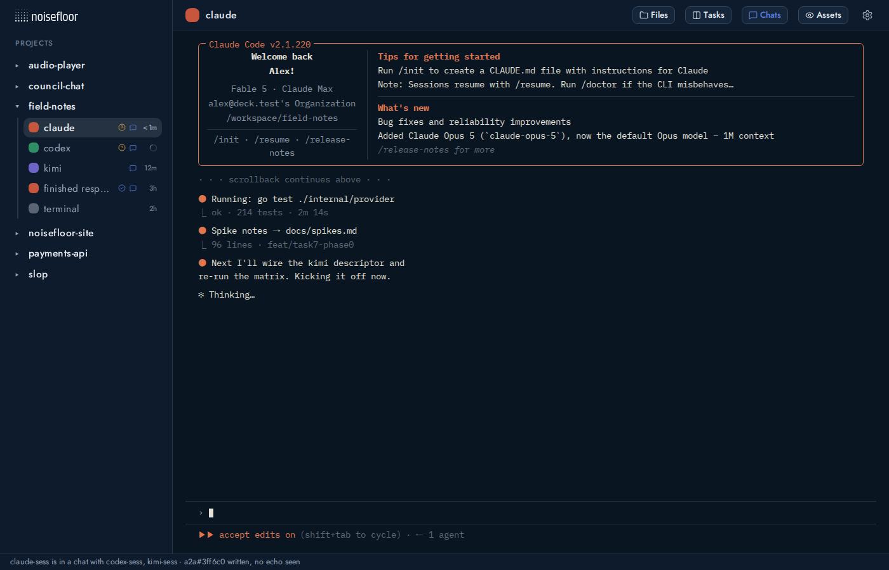
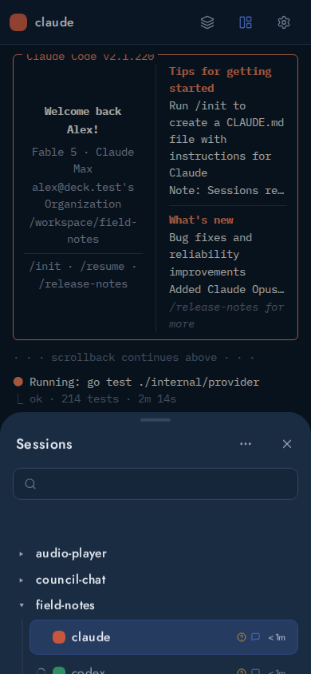

# Conversation badges

The sidebar shows a small question circle for pending agent input or approval,
and a check circle for an unseen completed turn. The check means the response
ended; it does not establish that the overall task succeeded. Existing recovery,
PTY output, and chat marks keep their separate meanings. Unsupported signals
remain unknown.

A completed turn is acknowledged only when its selected conversation is attached
and visible, in a visible browser tab, with no covering mobile drawer, expanded
file viewer, or dialog. Pending requests are not acknowledged by viewing them.
Acknowledgment compares the exact generation and completion revision, so a new
completion racing an old read remains unread. SQLite preserves read state across
polls, reconnects, and server restarts. A different next turn preserves unseen
completion; structured activity continuing the same turn invalidates its old
completion.

## Provider coverage

Contracts were inspected against the image's Codex **0.162.1** and Claude Code
**2.1.308**. Other providers have no native attention integration here.

| Provider | Input | Approval | Completed turn |
| --- | --- | --- | --- |
| Claude | `PreToolUse` for `AskUserQuestion` | `PermissionRequest`, uniquely correlated to an open tool by name | Native `Notification` with `notification_type=idle_prompt` and the current `prompt_id` |
| Codex, opt-in | `PreToolUse` for `request_user_input` | `PermissionRequest`, uniquely correlated to an open tool by name | Native `notify` event `agent-turn-complete`, with `turn-id` |

**Stop is an attempt, never a completion signal.** Native hooks, including a2a,
may block a Stop and continue the same turn. In pinned Codex, the legacy native
completion notification runs after the Stop blockers have allowed completion.
Claude has no equivalent immediate definitive callback used here. Its documented
`idle_prompt` notification arrives approximately 60 seconds after waiting for
input, and may be suppressed while background agents run or a quota wait is in
progress. This adapter does not implement a silence timer. Immediate Claude
completion badges are unsupported; callbacks missing native `prompt_id` remain
unknown. SessionEnd, even without a turn ID, clears pending state through the
lifecycle path and never creates a completion.

Claude post-tool success, failure, and permission-denial callbacks resolve exact
open tool IDs. Codex's pinned generic tool registry emits PostToolUse only on
success: failed/cancelled input and denied/failed tools can remain pending until
completion, interruption, SessionEnd, or a new turn. The adapter cannot infer
resolution where the provider supplies no callback. Claude sandbox network
approvals do not emit PermissionRequest and are unsupported. Ambiguous parallel
same-name tool approval requests become unknown. Subagent callbacks are ignored;
`agent_type` alone does not identify a subagent. User-owned custom commands and
other ways of asking questions have no badge unless covered by these contracts.

## Configuration and native consent

Claude's launch settings add the attention adapter alongside the unchanged
SessionStart identity hook. No transcript or terminal parsing is involved.
Existing sessions need a new launch with the updated image/settings to acquire
the launch-owned attention directory.

Codex's native hook trust remains user-controlled. This change does **not** add
trusted hook hashes or modify the existing identity hook provisioning. To opt in,
merge the hook entries from
[`codex-attention-hooks.json`](../../deploy/provider-hook/codex-attention-hooks.json)
into your native hooks configuration, retaining your existing hooks. Review and
approve the native configuration using Codex's normal consent mechanism. Also
configure the native notification command in your Codex config:

```toml
notify = ["/usr/local/bin/noisedeck-attention-hook", "codex-notify"]
```

If you already use `notify`, retain it and explicitly compose both consumers in
a user-owned wrapper forwarding the native JSON argument to each command. Do not
overwrite existing configuration. Hooks without native notify can show pending
requests but cannot claim completion. Native notify without the start/tool hooks
cannot establish a correlated turn and does not create badges.

Both integrations inherit the existing private generation capture credential
and local hook transport. The new endpoint cannot be reached through the browser
workspace proxy. Events are strictly bounded and fenced to the current provider,
native identity, working directory, generation, and launch marker. Monotonic
sequence fences make retries idempotent and reject stale or reordered callbacks.

The generation-owned private adapter file contains only identifiers/hashes,
working-directory routing metadata, counters, and state enums, including a
bounded content-free retry queue. It never stores prompts, tool arguments,
approval bodies, output, or credentials. Failed deliveries retry on subsequent
callbacks; this is best effort, not a background notification service. A prolonged
outage saturating the 128-snapshot queue retains the newest turn start/snapshot;
older undelivered history can be lost. Hook invocations have bounded waits;
callbacks under sustained contention may be unavailable rather than guessed.

## Validation

- Backend tests cover authentication, bounds, ordering/idempotency, identity and
  generation isolation, removed/inactive sessions, persisted read state, stale
  acknowledgment races, same-turn continuation, and browser route wrapping.
- Real Python adapter → authenticated test HTTP server → SQLite tests use
  native-shaped synthetic events for both providers, including blocked Stop,
  completion, and SessionEnd without a turn ID.
- `python3 deploy/provider-hook/attention_hook_test.py` covers parallel requests,
  ambiguity, failure/denial, subagents, stale turns, duplicates, content exclusion,
  and durable replay after a lost start delivery.
- `python3 deploy/provider-hook/probe_claude_attention.py` uses the real pinned
  Claude CLI against a synthetic loopback model and isolated test home. A native
  a2a Stop hook blocks once; the same prompt continues and the actual adapter
  emits start/lifecycle events without falsely completing. This does not test
  the delayed interactive idle notification or real account approvals.
- Frontend unit tests cover distinct accessible badges and acknowledgment races.
  After a normal free-font build, run
  `NOISE_BROWSER_WS=<pinned-service> node web/tools/conversation-badges-probe.mjs`
  and the existing `sidebar-idle-probe.mjs`. The new preview query
  `preview.html?conversation-badges` is explicitly synthetic and does not start
  a model CLI. Screenshots go to `.deck/assets/` locally.

The pinned Go linter reports zero issues on lines changed from v0.3.0. Its full
repository run reports 33 findings in unchanged code; the full lint gate is not
clean. Relevant Go suites, vet, web tests, build, and the probes pass.

The Codex completion ordering and request_user_input hook coverage are pinned
source evidence, not a claim of logged-in Codex CLI acceptance. No company or
customer sessions are used in these tests.

Sources: [Claude native hooks](https://code.claude.com/docs/en/hooks),
[Codex hooks](https://learn.chatgpt.com/docs/hooks),
[pinned Codex turn ordering](https://github.com/openai/codex/blob/rust-v0.162.1/codex-rs/core/src/session/turn.rs),
[pinned native notify](https://github.com/openai/codex/blob/rust-v0.162.1/codex-rs/hooks/src/legacy_notify.rs),
[pinned tool registry](https://github.com/openai/codex/blob/rust-v0.162.1/codex-rs/core/src/tools/registry.rs).

Synthetic preview captures (not live provider conversations):




